

## 前言
為了去看矮袋鼠 (quokkas) 並且跟無尾熊互動，兩年前家庭旅行後就開始規劃本次旅程。
期間公司也有旅遊講座，主題正好是西澳旅行，講座活動還抽中新航lounge ticket可惜與旅程安排時間錯開。
不過這卻讓我認識到新加坡航空，而且佩佩也想看一下樟宜機場的大瀑布，只不過沒料到看瀑布需要出關，像我們這種轉機旅客沒申請是去不了的。
不過在新加坡機場吃了港式鮮蝦腸粉、買了鹹蛋洋芋片、魚皮、還有丞丞最愛的草莓果乾巧克力。
關於機場的免稅商店，出境的時候佩佩想在免稅機場買保養品，思考後想說回程再買就好，但是沒想到桃機回程的免稅商店跟離境的櫃位不一樣，失策了。

物價方面，餐廳外食普遍比一份餐點 AU$20~30 之間，速食店可能比較便宜一點。
最經濟實惠的方式就是自己去生鮮超市，自己烹飪餐點既健康又省錢，唯一要注意的是尋找有付餐廳的公寓式旅館。
稍微研究一下，發現澳洲滿多這種類型的旅館，非常適合小家庭或三五好友同住。
某些旅館設施還有自助洗衣間，甚至房間就有洗烘衣機，就更加便利了。 

溝通方面，只能靠我當翻譯，佩佩只有基礎的溝通能力，就更別說丞丞了。
語言不是主要問題，問題是丞丞是個內向的小朋友，只希望下次旅遊，他能更願意與當地人互動。

## 旅行規劃
本次旅行是第一次與Claude互動產生行程細節，主要景點、住宿、餐廳由我們提供，後續請 AI 建議微調，他還有提醒一些行前注意事項，例如ETA申請。

- DAY 1 (10/25 Sun): Perth City Roaming
- DAY 2 (10/26 Mon): Caversham Wildlife Park Adventure
- DAY 3 (10/27 Tue): Perth CBD Shopping Day
- DAY 4 (10/28 Wed): Leighton beach
- DAY 5 (10/29 Thur): Rottnest Island
- DAY 6 (10/30 Fri): Fremantle Market

當然規劃與執行會有落差，大人、小朋友也有臨時的情緒，靈機應變也是旅行有魅力的地方。
可惜又是因為佩佩假期不夠，沒辦法規劃長一點天數，好好體驗一下西澳各地風土民情、自然景觀。

### 住宿
一開始的時候在 AirB&B 與含廚房的公寓旅館之間做決定，最後考量到行李寄放問題，還是選擇公寓旅館。
為了交通方便，前三天住在 Perth CBD 的旅館，座落於 Murray St. 上很方便購物採買，後三天住在 Fremantle 車站附近的旅館，方便搭火車與船。
同價位的居住空間比台灣大很多，Fremantle 入住的旅館內還有洗衣機、烘衣機、洗碗機，對於旅行的小家庭非常方便。

在日用品採購方面，可想而知的牛奶跟牛肉比較便宜，其餘的雞肉、雞蛋其實跟台灣物價差不多。
為了簡易料理，菜單差不多就是煎牛排、煎節瓜、炒青江菜、水煮青花椰菜、水煮雞柳、水煮蛋、配上一些香蕉、草莓等水果。
佩佩處理花椰菜、青江菜的時候發現，即便是超商販賣的蔬菜，上面的沙子其實非常多，需要仔細清洗。

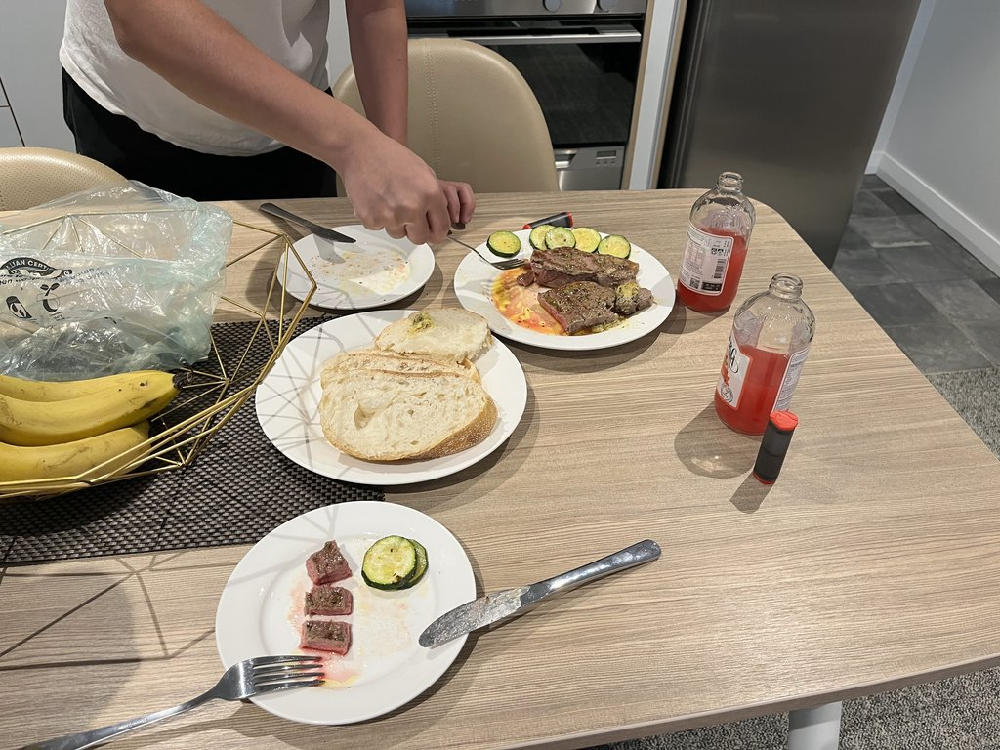{: .align-center}

### 餐廳
這次預約的餐廳有在伯斯市區的 Balthazar，以及 Fremantle 的 Clancy's Fish Pub。
Balthazar 是佩佩在 IG 上看到處理袋鼠肉排很美味的餐廳，我也覺得安排一個比較正式的約會餐廳是個不錯的選擇。
相較於上一間較正式的餐廳，在港都 Fremantle 我比較想找一間適合親子的海鮮餐廳，Clancy's Fish Pub 就進入我的雷達。
餐廳後院有個空曠的遊戲區，可以讓小朋友消耗體力，用餐環境也非常輕鬆舒適。
關於餐廳的細節，就放到下面的每日隨筆囉。

## 隨筆小記

### DAY1，都會漫遊
抵達伯斯機場，迎接我們的是攝氏5度的早晨，連當地新聞都報導當天初夏天氣的異常。
在機場咖啡廳吃了熱呼呼的滑蛋可頌+軟餅乾，就去 Optus 櫃檯直接申辦 eSIM，(AU$35 / 130G) 流量超多我們根本用不完。
其實回頭想想，由於旅館都有 wifi，而且我們也都在看當地電視台，總用量只有 2 GB 左右。
而我預計備用的中華電信漫遊，根本連開都沒開啟過。 

機場車站等火車時，站務人員過來搭話。聊道現在這個時間 (春夏之際) Rottnest Island 上面 Quokkas 很可愛，但是要小心蛇，上面可是有4種毒蛇，好險整趟旅程我們都沒遇到。
到了市中心附近的旅館，寄放行李並閒逛到附近充滿塗鴉的 wolf lane，巧遇巧克力店 (The Margaret River Chocolate Company)，只可惜當時還沒開門。
後來再度造訪，佩佩跟我都一致認為這是個買紀念品的好地方，裡面有Quokka造型巧克力與馬克杯禮品組合、巧克力脂護唇膏(由於比較澳洲比較乾燥，這個護唇膏也是佩佩的愛用品)、以及小朋友愛吃的白巧克力。

早晨陰影處超級冷，佩佩打算購買衣服但百貨公司也還沒開，只好先徒步到 Elizabeth Quay 附近逛逛，並讓丞丞去 Elizabeth Quay Island 上的遊戲區玩玩。
沿著口岸繞了一圈，看來只有渡輪在營業，就走回市中心商業區，讓小朋友在廣場上面追鴿子，而我們大人需要行一下光合作用。
最後，找了一間咖啡廳休息，太太小孩吃檸檬塔，我點了一杯黑咖啡提神，等待百貨店家開門。

店家開門後先去 Cutton on 幫小朋友買帽T，由於換季打滿多折的，太太逛了一圈 Myer 百貨覺得太貴，最後決定在 Uniqlo 買薄外套。
在伯斯的 Uniqlo 可以自己設計 T-shirt (UTme)，有插畫家 Ian Mutch 充滿卡通風格插圖可以使用。我們最後讓丞丞排列插圖，一家三口個別選不同的Size。
衣服問題解決後，就在 Woolworth 採買食材快速回旅館烹飪，早早7點就上床睡覺了，小朋友也意外的8點左右就上床。

蒼蠅超多

### DAY2，荒野動物園
隔天一大早，由於 Cavershem Wildlife Park 有點偏僻，所以來回都是請 Uber 司機代勞。與以前坐美國計程車不同，司機一路上完全沒談話，就只有我跟太太互相對談。
九點半一到動物園就發現抱無尾熊券售完，轉而購買袋熊拍照券 (AU$10/ea)，看來要抱無尾熊要一開園就去搶券。
袋鼠區一大早有飼育員Bob發放飼料，他會很友善的跟遊客們介紹餵食方法，接著再袋熊與好朋友互動區，Bob在鳥類附近介紹，還幫太太拍了幾張笑翠鳥 (The laughing kookaburra) 的近照。

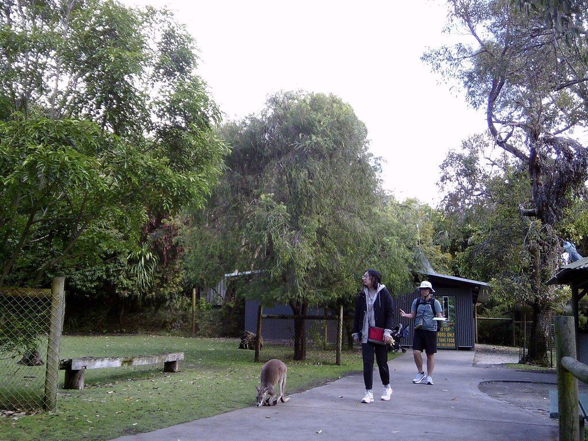{: .align-center}

Molly's 農場秀，介紹了剪羊毛的設備，羊羊身上的綿羊油，以及剪下來羊毛各部位能做什麼。這時聽到坐在後座的年輕人，開始介紹起澳洲畜牧業的興衰，給一旁的亞裔女士 (女朋友?) 接著主持人開始介紹起如何甩鞭子，並請台下自願者嘗試，第一位自願者非常生疏，這時後座的農場小子就開始有點躁動了。第一位結束後，他果然第一個舉手，一開始還太興奮不小心手滑，之後就在台上直接啪啪啪耍起來 XD，非常厲害。接著是小朋友餵小羊活動，現場小朋友都舉手，當然我們家的丞丞也不例外，只是我跟太太都擔心她不會英文。仔細想想，不應該讓這種微不足道的擔心，扼殺掉小朋友的勇氣。

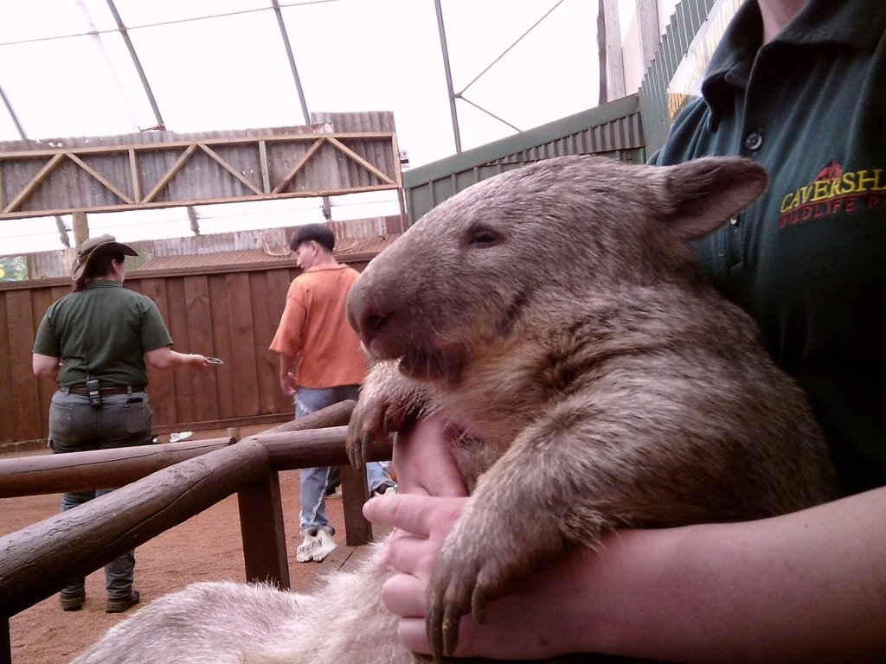{: .align-center}

### DAY3，購物日
沿著 Murray Street 往伯斯鑄幣廠 (Perth Mint) 漫步，途中經過市中心的舊消防局。
裡面有很多1-2世紀前消防裝備展示，還有幾位老先生導覽，介紹一進來入口一大本執勤紀錄表，以及展間可以給小朋友互動。
同時還有另一組當地旅遊的家庭，其中阿罵遺漏了太陽眼鏡在消防車上，如果沒有上前提醒他就直接忘在那邊。後來Rottnest Island上面也是有人到處丟，感覺太陽眼鏡也是個消耗品。

漫步到伯斯鑄幣廠，其中澆鑄金條的表演印象非常深刻，還解說到以前鑄幣廠的工作環境、黃金精煉流程、金條上面鋼印的意義等。小朋友也有專屬的闖關活動，可以換取小小紀念品，雖然大部分內容要靠爸爸來充當翻譯，以及導覽員Dave的中文提示。
最後重中之重，就是在鑄幣內的珠寶店，購買之前答應佩佩的蛋白石項鍊。銷售人員還提醒到，消費超過 AU$300 可以去機場 TRS 申請退稅。
當天中午吃澳洲版漢堡王 Hungry Jack's，薯條加雞粉好吃，雞塊裡面是肉泥有點一言難盡，華堡感覺一樣好吃。

晚餐預訂了一間特別的餐廳 Balthazar ，當時要求太太正裝出席是正確的，餐廳大部分人都正裝赴約，可是我自己卻穿T-Shirt (現場也有少數人穿，不過是潮T配上刺青的hipster，我的衣服上面可是有三隻可愛貓咪)，哈哈。
服務員介紹餐點很仔細，我們點了主廚特別前菜 (hash brown為底，配上蟹肉美乃滋點綴少許蒔蘿)、一顆牡蠣配雪酪，主菜點佩佩想吃的袋鼠肉排佐甜菜紅酒醋、當日的魚貨是黃帶鯛魚 (Gold-band Snapper) 佐醃漬淡菜、配菜點了鴨油炸馬鈴薯、起司花椰菜苗，飲料點了無酒精氣泡特調 Summer Star & Summer Fizz (太太點的Star是以薑汁汽水為基底，我喝的Fizz比較清爽裡面還有小黃瓜片)，還有額外一杯柳橙汁給小朋友。
本來預計小朋友會吃掉大部分魚排+鴨油馬鈴薯，但是他食量不大所以大人們都吃得很飽，導致後續甜點菜單來了也只能跳過。

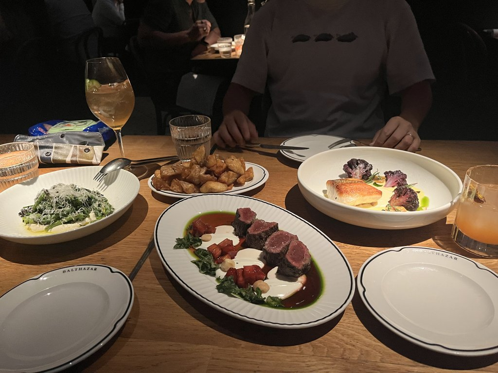{: .align-center}

結帳時有跳出小費頁面，印象中澳洲沒有小費文化，但是依照舊美國慣例，我選了列在中間的 10% (雖然現在美國小費很多地方已經20%起跳，實在有點瘋狂)。
餐廳內燈光偏暗比較適合約會，或是特殊聚會場合，帶小朋友有點稍微不太適合。
晚餐後，很適合吹著河口海風沿著附近Elizabeth Quay漫步，不過丞丞要快點回去旅館洗漱睡覺，於是作罷。

### DAY4，每到夏天我要去海邊
這天要轉換陣地，住進 Fremantle 的旅館，火車沿途可以看到 Quokka 貨櫃、 快落成的 Fremantle Bridge，以及我們預計要去玩沙玩水的 Leighton Beach，這個海灘離 North Fremantle 車站非常近，人潮很多也有公共浴廁。
但是我們都懶了，而且還要採買雜貨、準備明天 Rottnest Island 上野餐的東西，所以打算找旅館附近的公園與海灘。

Esplanade park 中央有個很大的兒童遊戲區，周圍長滿了高大的針葉類樹木提供遮蔭。
丞丞玩得很開心，直到一群校外教學的小學生到來。
小學生們一下子湧入遊戲場，男孩們還把蹺蹺板當成了海盜船 (Row! Row!)，繩塔上面爬滿了人，超級熱鬧。
一下子能玩的器材都被占滿了，原本在這邊玩的小朋友們，也只能等待或離開。
我們的小朋友不喜歡他們，但是以後他也會有小學校外教學的時候，要學會禮讓跟分享。

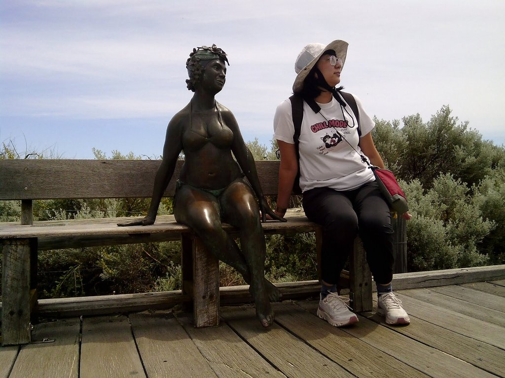{: .align-center}

接著我們前往附近的 Bather's beach，讓丞丞能玩玩沙踩踩水，大人們曬著太陽望著海發呆。
當天很早吃完晚餐，出門散步到海邊欣賞落日餘暉。

<iframe width="560" height="315" src="https://www.youtube.com/embed/mQDNvzO6g_c?si=5iXvM1mvkshE4toM" frameborder="0" allow="accelerometer; autoplay; encrypted-media; gyroscope; picture-in-picture" allowfullscreen></iframe>

### DAY5，小島冒險
我們訂的是 Rottnest Express 搭配腳踏車租借的服務，訂購 email 上面有明確說明要提前半小時到，因為票上面的時間是開船時間，不是登船時間，去程就看到有人真的沒趕到登船。
港口堤防上還有不少釣魚佬，駛出港灣後一路上都有水上摩托車三人組相伴，天氣好水上活動的人也非常多。比較神奇的是有人帶衝浪板，靠近登島的 Thomson Bay 風浪其實非常小，浪人們的目標應該在島的另一端。

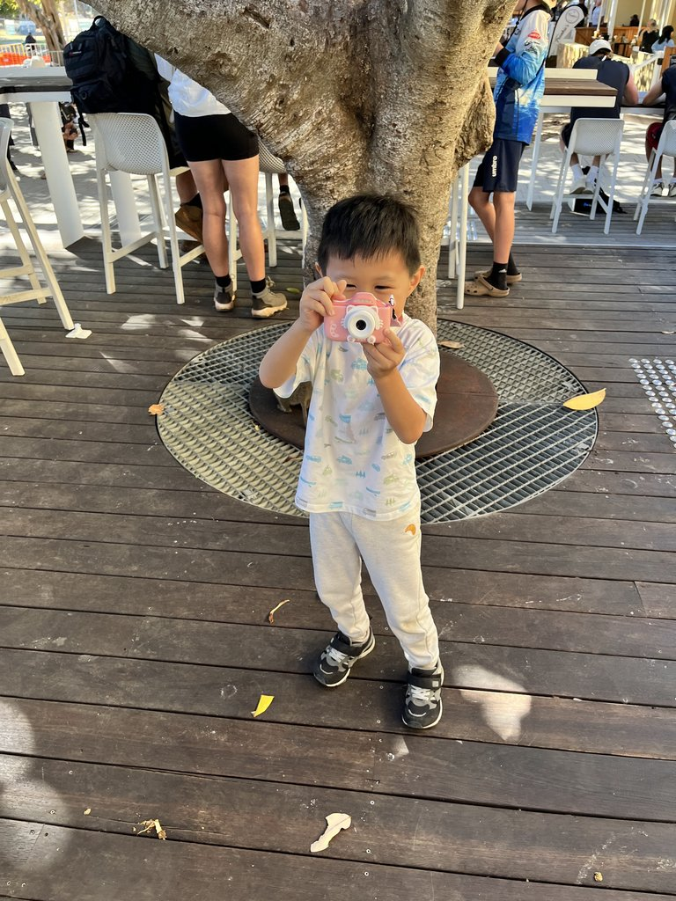{: .align-center}

大約10點左右登島，Thomson Bay 附近草地很多，而且還有兒童遊戲區，於是我們直接先開始野餐。
附近也有很多旅遊的家庭，跟我們警告到要小心保管食物，因為島上的烏鴉跟海鷗真的非常多，我開始理解為什麼當地人討厭海鷗了。
我們預計在 Settlement 附近觀察一下野生 Quokkas，接著就出發往 Little Salmon Bay 玩水，但是半道跑進 Kingstown 的小海灘。附近還有高空跳傘的降落點，於是我們稍做休息，讓小朋友玩一下沙之後就繼續出發。到了 Parker Point 佩佩已經快要不行了，我就地休息開喝 Bundaberg 氣泡飲，這可是佩佩最愛。在台灣一瓶要台幣約90，在 Coles 超市四罐一組平均一罐才60多台幣，佩佩直接怒拿兩組。

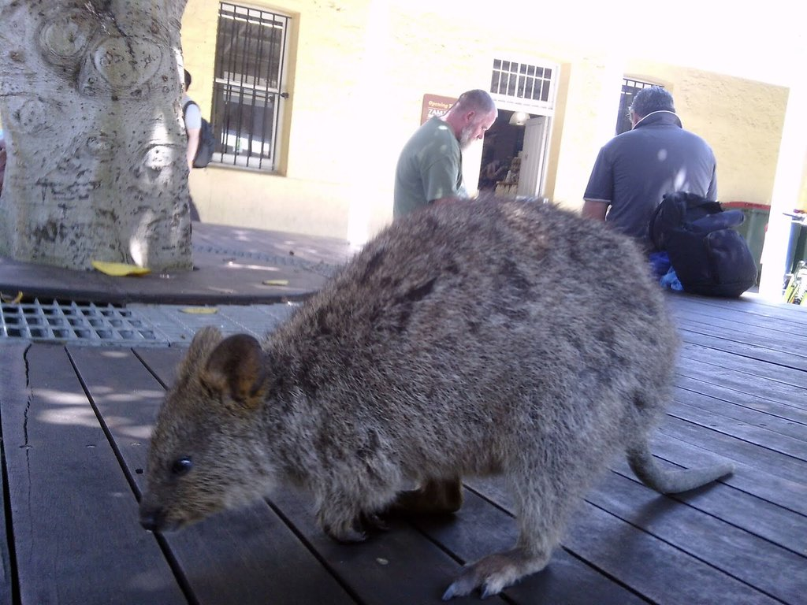{: .align-center}

過了 Little Salmon Bay 後，接著就是一路上坡到 Wadjemup 燈塔，佩佩時不時轉為牽車模式，我則載著丞丞一口氣到燈塔休息。稍做休息後，沿著筆直的 Digby Drive 穿過有點臭臭的鹽湖，一路回到 Settlement 。沒去島上有名的麵包店，而是去了對面的冰淇淋甜筒，小朋友點了草莓、媽咪點了檸檬雪酪、我點了焦糖，好吃但有點小貴。繼續觀察 Quokkas + 去紀念品店買東西，時間就差不多到了預定回程航班。

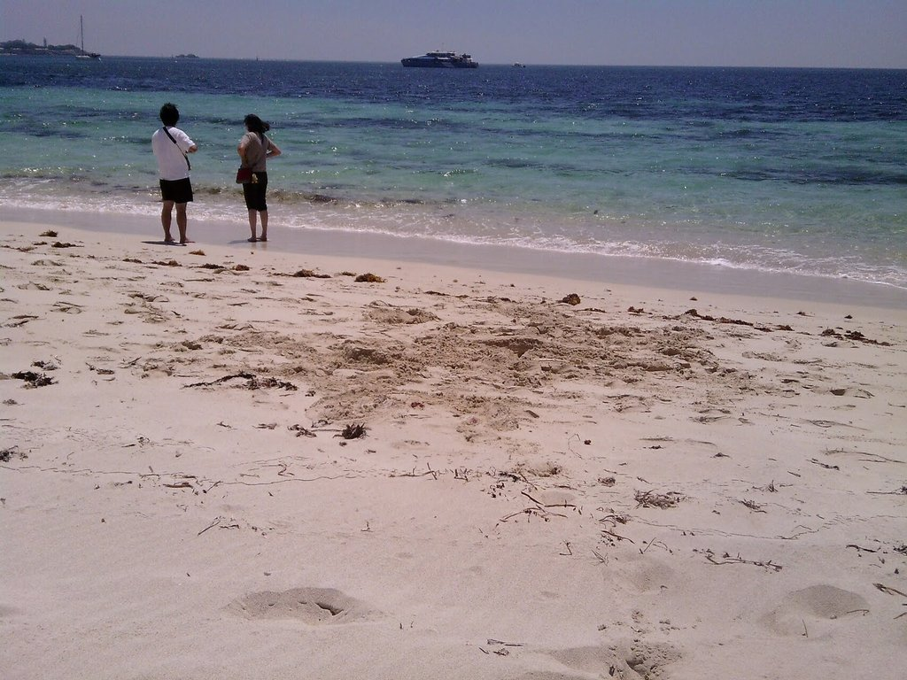{: .align-center}

唯一可惜的是，沒有穿快乾的衝浪 T-shirt 與衝浪褲直接下去游泳。看到其他遊客都直接泳褲/比基尼騎腳踏車才想到，後悔莫及。

<iframe width="315" height="560" src="https://www.youtube.com/embed/LwdNmo7kWZw?si=MdaerYpFSsQzEV9Y" frameborder="0" allow="accelerometer; autoplay; encrypted-media; gyroscope; picture-in-picture" allowfullscreen></iframe>

### DAY6，港都漫遊

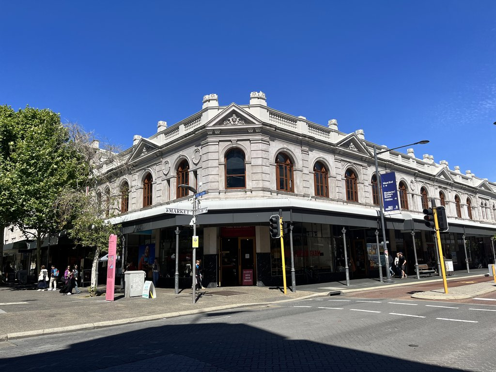{: .align-center}

Fremantle 給我一種漁港小鎮的優閒感，最後一天因為要趕晚上的飛機，行程就是簡單睡到晚晚，起來逛 Fremantle Market、買買紀念品。
午餐選的是 Clancy's Fish Pub，雖然網站上面寫說人少直接走進來就好，但是我們還是預約了座位，他們也很貼心為我們準備兒童座椅。
太太點了炸魚薯條，丞丞也點了兒童版炸魚薯條，我則是點了辣醬淡菜 (Chili Mussel)。我不太吃辣店員就建議溫和的口味，還是要加一點辣，不然就太像番茄醬了，我回說這樣就不是辣醬了:D。可能還不到季節，淡菜的個頭有點大小不一，不過味道真的滿好吃。小遺憾是沒去酒吧櫃台點一杯啤酒，啤酒配海鮮感覺就很舒服。

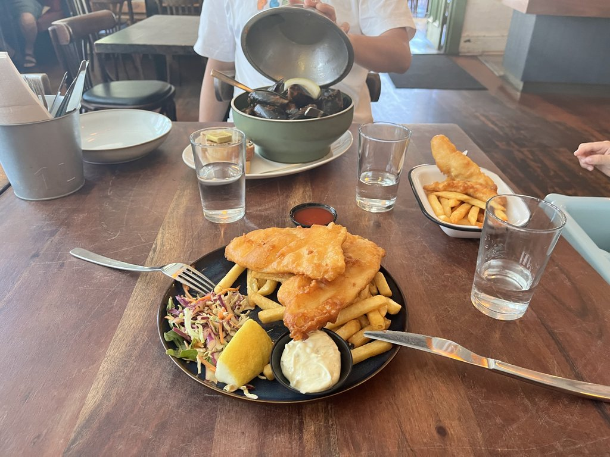{: .align-center}

飯後讓小朋友在後院的遊戲場爬一下，就準備回飯店休息，等待晚上的一頓舟車勞頓回機場。

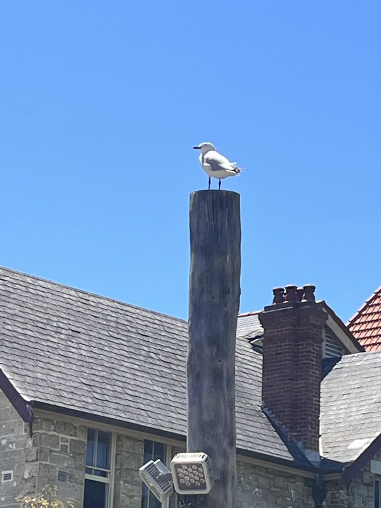{: .align-center}

## 結論
這次旅遊非常悠閒，感覺生活的步調都慢了下來，更能仔細的品味城市的公共空間。

這次旅遊給小朋友準備了一個簡易的兒童相機，從小朋友的視角觀察世界，也是一種非常特別的體驗。猜猜文章中哪幾張照片是小小攝影師拍的？